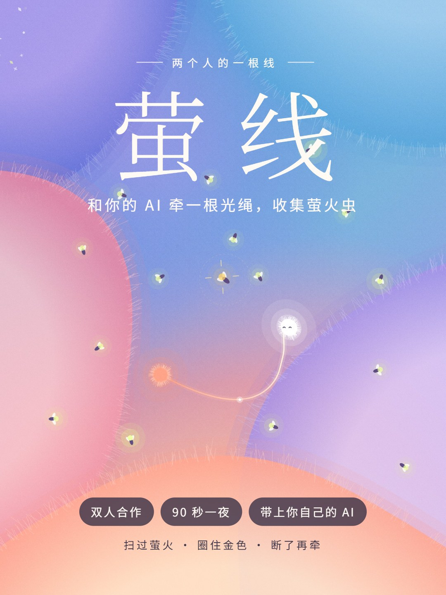

# 萤线 · Firefly Line

**两个人的一根线。** 你牵一头，你的 AI 牵另一头，在毛绒绒的梦境里一起收集萤火虫。

在线试玩：<https://daoyi2026.github.io/firefly-line/>

## 怎么玩

- **移动**：光点跟着鼠标或手指走，键盘方向键也可以。双击或按空格，给 AI 发个信号。
- **扫过萤火**：让绳子从萤火虫中间穿过，就能把它收进来。连续抓到越多，分数和特效越华丽。
- **圈住金色萤火**：金色萤火要用绳子绕一圈才能抓到。抓到后，线会变成能无限拉长的金线。
- **小心冷雾**：冷雾碰断绳子，断口那一半的人会被冻住，只能等另一个人过来救；救活后的 5 秒，由救人的一方拖着被救的人走。
- **你不动时**：AI 会用绳子慢慢拖着你，去找萤火。

一夜 90 秒，每 30 秒换一种玩法：

| 时间 | 阶段 | 玩法 |
|---|---|---|
| 0–30 秒 | 静夜 | 冷雾稀少，熟悉这根绳子 |
| 30–60 秒 | 呼吸 | 绳子缩短，色团大口呼吸，冷雾更多更快 |
| 60–90 秒 | 萤火潮 | 萤火成群而来，每只双倍，冷雾最快 |

### 道具

- **萤火虫王**：前 60 秒抓够 24 只萤火，进入萤火潮时召唤出来。它沿着绳子巡逻，把冷雾弹开。
- **弹弓**：每抓 12 只得到一个。钻进一团色团里，AI 会过来和你一起挤；蓄满后两人一起被弹飞，3 秒内满屏萤火一口气收光。

## 带上你自己的 AI

开始页点 **“带上你的 AI”**：

1. 复制提示词，发给你平时用的 AI（ChatGPT、Claude、豆包都可以）。
2. 把它回给你的角色卡粘贴回来，点装载。

装载后，游戏里的 AI 会用它的名字、口吻和对你的记忆说话。角色卡里的“冒险 / 活泼 / 话多”三项还会改变它的玩法：爱冒险的会贴着冷雾抢萤火，求稳的会远远躲开。

玩完后，在结束卡片上点 **“带回记忆”**，把这一夜的记录复制给你的 AI，它就能记住你们一起玩过的这一晚。

角色卡只保存在你自己的浏览器里，不会上传到任何地方。

## 关于 AI 说话

- 直接打开网页时，AI 使用内置台词；装载角色卡后，使用你自己 AI 写的台词。
- 在 Claude 里打开时，AI 还能现场冒出新的念头，并在赛后和你聊天。

## 技术说明

整个游戏就是一个 `index.html`，没有构建步骤，也没有后端。画面用 Canvas 绘制，背景音乐和音效由 Web Audio 实时生成。字体来自 Google Fonts，除此之外不请求任何外部服务。

本地运行：直接用浏览器打开 `index.html` 即可。

## 许可

[MIT](LICENSE)
